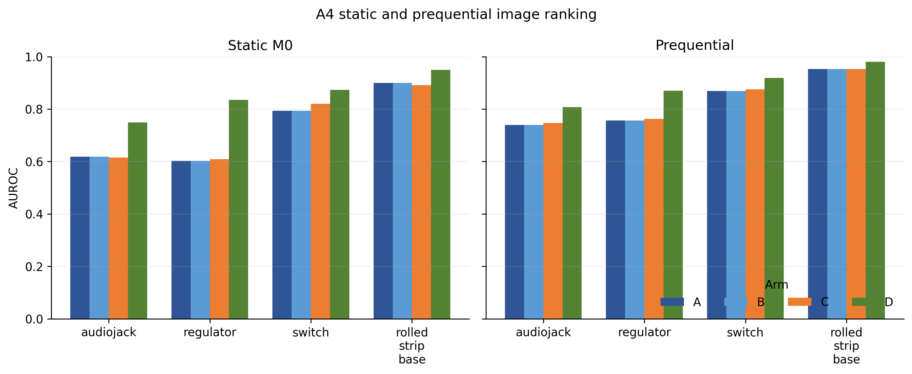
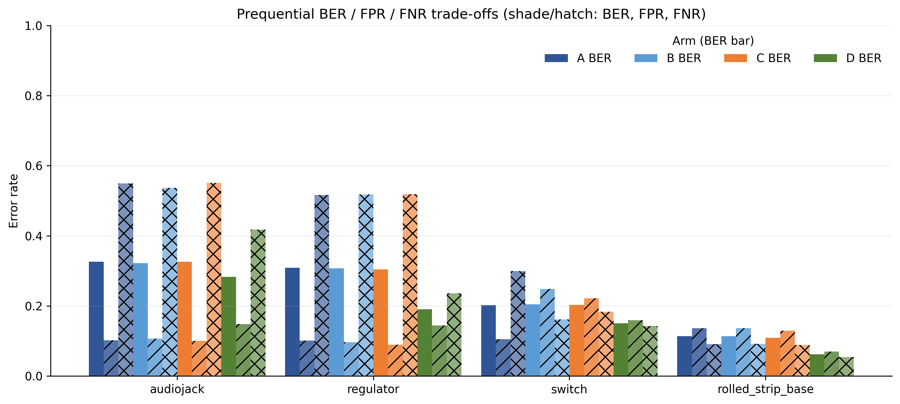
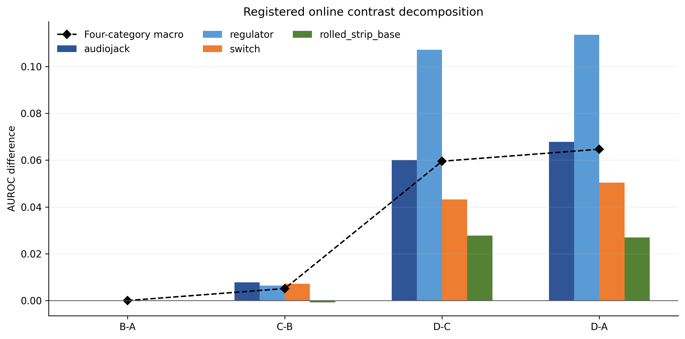
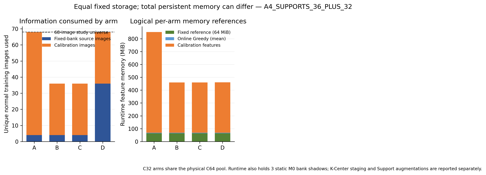

# Experiment A4 integrated report

**Run:** `a4_eb68_20261107_full05`
**Protocol:** `A4_EB68_v1`; P0 only; four previously exposed development categories.
**Classification:** `A4_SUPPORTS_36_PLUS_32` — The 36+32 allocation is materially competitive under the registered criterion.

## Question and allocation

The reviewer question was whether 64 additional labelled normal commissioning images should be reserved for calibration or used to strengthen the fixed normal reference. Every category used exactly the A1 seed-0 Support-4 plus the same historical additional C64 identities: 68 distinct normal TRAIN image identities from distinct official Source Groups, disjoint from TEST groups. A1 draw-0 C32 membership was preserved, and R32 was its exact complement. This is four Supports plus **additional** C64; it is not strict four-shot total.

Arm A used the historical native four-Support fixed bank and C64 B3. B shared A's exact fixed bank, writer, dynamic memory and score trajectory but used C32 B3. C used the registered A3b K-Center algorithm on the same Support augmentation descriptors and C32 calibration. D used that same K-Center algorithm on Support-4 plus the complementary R32 descriptors and C32 calibration. Each fixed bank held 8,192 × 4,096 fp16 prototypes (67,108,864 bytes). D selected from the exact 65,536-descriptor, group-balanced candidate cap. C32 never entered a fixed reference.

## Results

| Category | A static / online | B static / online | C static / online | D static / online | D−A online AUROC |
|---|---:|---:|---:|---:|---:|
| audiojack | 0.6182 / 0.7393 | 0.6182 / 0.7393 | 0.6158 / 0.7470 | 0.7490 / 0.8071 | 0.0678 |
| regulator | 0.6027 / 0.7566 | 0.6027 / 0.7566 | 0.6087 / 0.7630 | 0.8350 / 0.8701 | 0.1135 |
| switch | 0.7933 / 0.8686 | 0.7933 / 0.8686 | 0.8199 / 0.8757 | 0.8737 / 0.9189 | 0.0504 |
| rolled_strip_base | 0.9001 / 0.9534 | 0.9001 / 0.9534 | 0.8918 / 0.9526 | 0.9495 / 0.9803 | 0.0270 |

Category online BER / FPR / FNR, in arm order A, B, C, D:

| Category | A BER/FPR/FNR | B BER/FPR/FNR | C BER/FPR/FNR | D BER/FPR/FNR |
|---|---:|---:|---:|---:|
| audiojack | 0.3257 / 0.1020 / 0.5494 | 0.3217 / 0.1064 / 0.5370 | 0.3257 / 0.1004 / 0.5509 | 0.2828 / 0.1481 / 0.4174 |
| regulator | 0.3090 / 0.1013 / 0.5167 | 0.3071 / 0.0966 / 0.5176 | 0.3038 / 0.0890 / 0.5185 | 0.1899 / 0.1438 / 0.2361 |
| switch | 0.2017 / 0.1046 / 0.2989 | 0.2045 / 0.2481 / 0.1610 | 0.2027 / 0.2218 / 0.1836 | 0.1506 / 0.1588 / 0.1424 |
| rolled_strip_base | 0.1133 / 0.1359 / 0.0907 | 0.1137 / 0.1359 / 0.0915 | 0.1086 / 0.1289 / 0.0883 | 0.0619 / 0.0695 / 0.0543 |

Four-category equal-weight online macro AUROC/AP: A 0.8295/0.7523; B 0.8295/0.7523; C 0.8346/0.7614; D 0.8941/0.8562. Static macro AUROC: A 0.7286, B 0.7286, C 0.7341, D 0.8518.

## Registered contrasts

| Contrast | Macro AUROC Δ | Macro BER Δ | Macro FPR Δ | Macro FNR Δ |
|---|---:|---:|---:|---:|
| Calibration B−A | 0.0000 | -0.0007 | 0.0358 | -0.0371 |
| Selector C−B | 0.0051 | -0.0016 | -0.0117 | 0.0086 |
| Reference D−C | 0.0595 | -0.0639 | -0.0050 | -0.1228 |
| Total budget D−A | 0.0647 | -0.0661 | 0.0191 | -0.1514 |

Category-level differences:

| Category | Contrast | AUROC Δ | BER Δ | FPR Δ | FNR Δ |
|---|---|---:|---:|---:|---:|
| audiojack | B−A | 0.0000 | -0.0040 | 0.0044 | -0.0123 |
| audiojack | C−B | 0.0077 | 0.0040 | -0.0060 | 0.0139 |
| audiojack | D−C | 0.0600 | -0.0429 | 0.0476 | -0.1335 |
| audiojack | D−A | 0.0678 | -0.0429 | 0.0461 | -0.1319 |
| regulator | B−A | 0.0000 | -0.0019 | -0.0047 | 0.0009 |
| regulator | C−B | 0.0064 | -0.0033 | -0.0076 | 0.0009 |
| regulator | D−C | 0.1071 | -0.1138 | 0.0548 | -0.2824 |
| regulator | D−A | 0.1135 | -0.1190 | 0.0425 | -0.2806 |
| switch | B−A | 0.0000 | 0.0028 | 0.1435 | -0.1379 |
| switch | C−B | 0.0071 | -0.0019 | -0.0263 | 0.0226 |
| switch | D−C | 0.0432 | -0.0521 | -0.0630 | -0.0411 |
| switch | D−A | 0.0504 | -0.0511 | 0.0542 | -0.1565 |
| rolled_strip_base | B−A | 0.0000 | 0.0004 | 0.0000 | 0.0008 |
| rolled_strip_base | C−B | -0.0008 | -0.0051 | -0.0070 | -0.0032 |
| rolled_strip_base | D−C | 0.0277 | -0.0467 | -0.0594 | -0.0341 |
| rolled_strip_base | D−A | 0.0270 | -0.0514 | -0.0664 | -0.0364 |

`B−A` AUROC/AP are exactly zero by construction and test; the calibration allocation changes operating decisions, not scores. Its macro online BER/FPR/FNR differences were -0.0007/0.0358/-0.0371. `C−B` changes the Support-only fixed-reference constructor and includes any legitimate downstream Greedy effects. `D−C` adds R32 to that same K-Center constructor. `D−A` is the registered full allocation contrast: representation and calibration allocation both change, so it does not isolate B3.

## Online memory and operation

| Category | Queries | Query rate | Queried normals | Queried defects | Native writer calls | Accepted candidate prototypes |
|---|---:|---:|---:|---:|---:|---:|
| audiojack | 114 | 2.9882% | 75 | 39 | 225 | 1896 |
| regulator | 116 | 3.0091% | 87 | 29 | 261 | 2120 |
| switch | 115 | 3.0105% | 59 | 56 | 177 | 1480 |
| rolled_strip_base | 114 | 2.9961% | 37 | 77 | 111 | 936 |

The A4 writer reference was frozen at each bank's C32 M0 higher-q90 and sample standard deviation (floor 0.02), separately from live B3. This matched writer rule is A4-specific; historical R9/A2 used its registered C64 writer reference. A/B used one shared writer call per queried normal; C and D used independent calls. Unqueried outcomes never entered the controller, and queried defects had no normal-memory write.

For D, prequential minus static macro AUROC was +0.0423; category differences were audiojack +0.0581, regulator +0.0351, switch +0.0452, rolled_strip_base +0.0308. This is the observed within-D online change under its stronger fixed reference; it does not imply every category improved.

## Storage and compute

Every logical arm used a 67,108,864-byte fixed bank. A/B shared one online bank; three distinct online fixed banks and three static M0 scoring shadows were resident per category. Dynamic Greedy memory, the unique C64 calibration tensor pool, its source images, Support augmentation features, identity metadata, and coreset staging are reported separately in `EXPERIMENT_A4_RESOURCE_ACCOUNTING.json`; equal fixed storage did not equalize total runtime memory. A retained 49 GB TEST feature cache was unnecessary: TEST images were encoded once in stream order and the current feature was shared across all arms. C32 logical references share tensors from that C64 pool. D's 65,536×4,096 fp16 candidate matrix and its temporary CUDA float32 expansion were not retained in the run output.

Mean category wall time was 437.0s; mean TEST feature encoding was 138.2s; mean Support/C64/D-R32 identity feature encoding was 2.3/2.3/11.9s. Mean C and D K-Center candidate staging took 0.1/0.7s; K-Center selection including deterministic repeats took 18.1/33.6s. Mean static and online native scoring times were 49.7s and 83.5s; calibration native scoring took 0.7s. Mean protected-reference rescoring after genuine Greedy state changes was 47.5s. Per-category costs are in the resource JSON.

## Answers to the registered questions

1. **Q1 — 4+64 versus 36+32:** D−A macro online AUROC was +0.0647; per-category differences are shown above. Registered classification: `A4_SUPPORTS_36_PLUS_32`.
2. **Q2 — Support-only K-Center effect:** C−B macro AUROC was +0.0051. This includes legitimate downstream state differences.
3. **Q3 — Add 32 normals to K-Center reference:** D−C macro AUROC was +0.0595.
4. **Q4 — C64 versus C32 calibration:** B−A score ranking was identical; macro BER/FPR/FNR differences were -0.0007/0.0358/-0.0371 on the shared score trajectory.
5. **Q5 — Does Greedy help under D?** D prequential minus static macro AUROC was +0.0423; category-specific changes are stated above.
6. **Q6 — Retain C64+B3?** The 36+32 allocation is materially competitive under the registered criterion. The result supports retaining C64 as the baseline only if the registered criterion favors A; otherwise treat the result as mixed or retain the competitive alternative for this exposed development scope. Safety metrics must be inspected separately.
7. **Q7 — Defensible manuscript statement:** The same 68 normal training identities were allocated between calibration and fixed-reference construction in a registered development comparison. The observed category and macro results quantify sensitivity to this allocation for P0 on four exposed categories; they do not establish strict few-shot access, independent confirmation, or population-level superiority.

## Interpretation and limits

Native Support construction and K-Center differ in algorithm and prototype geometry; it is a deliberate comparison factor. C−B estimates changing that constructor on the same four Support images, with subsequent online state differences included. D−C estimates the registered expanded K-Center reference. The full A/D comparison changes both the fixed bank and B3 calibration allocation. AUROC ranking does not guarantee acceptable FPR/FNR; the operating-point table and window diagnostics must be considered separately. Official Source Groups are the operational identity unit and do not prove distinct physical objects. These categories were previously exposed development data, not confirmation data.

No masks, other categories, confirmation outcomes, new query policy, Correction, BEA, or TEST-driven parameter selection were used. The complete run, source and Stage A/B seals remain in `E:\Memory-Governed-Online-Few-Shot-Anomaly-Detection\outputs\calibration\a4_equal_budget_20261107\a4_eb68_20261107_full05`. The source-freeze commit is recorded in the run manifest; the report commit does not alter executed source.
