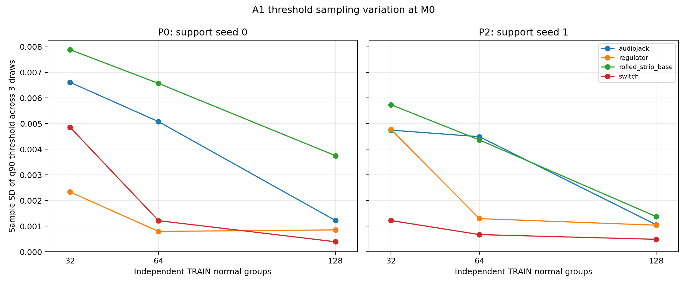
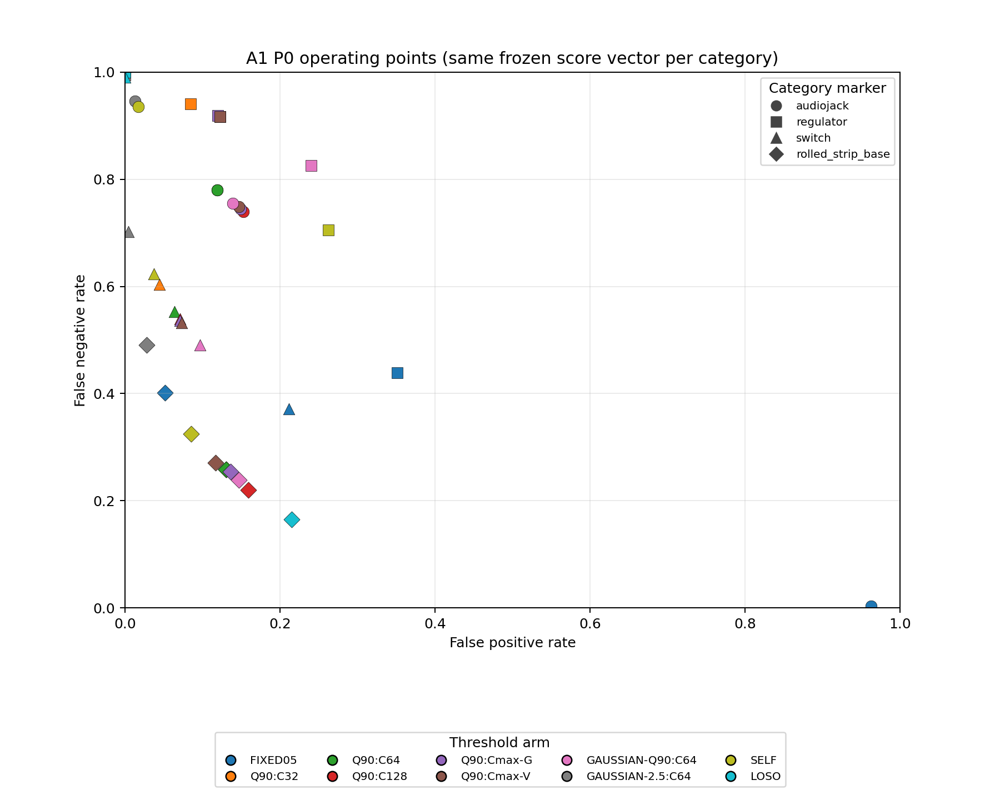
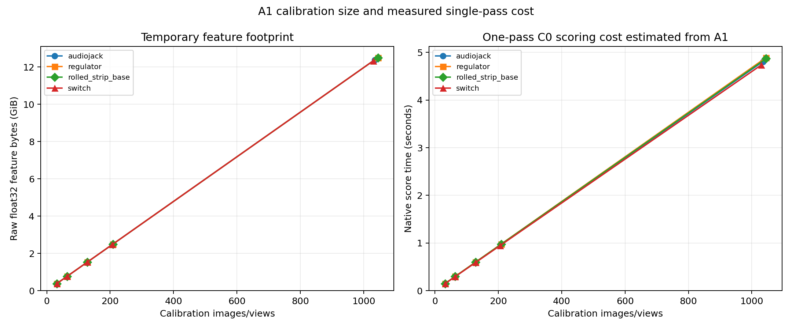

# Experiment A — Calibration Scale, Initialization and State-Dependence Audit

**Run:** `20261106_a1_full01`
**Scope completed:** A1 only
**Study type:** four-category development study; not independent confirmation.

## Questions and hypotheses

A1 tested whether the historical additional C64 calibration set yields a stable initial operating threshold; whether nested C32/C128/Cmax pools change threshold stability and the normal-tail behavior; and how SELF, LOSO, fixed raw score 0.5, empirical q90, and Gaussian moment comparators move the operating point. A1 does not answer whether calibration changes future learning; that requires A2/A3 trajectories.

## Protocol and implementation identity

Branch `calibration-stage0-contract-20261029`; parent `1c8dad859bba886438152491644dff0adbfe4336`. The verified DINOv2 ViT-L/14 register checkpoint SHA-256 is `36e4deffbaef061a2576705b0c36f93621e2ae20bf6274694821b0b492551b51`; local source-tree SHA-256 is `b7c0037f90671c4932393bd56de8c8a205b29a6eb22dea563b6c8a88c471da15`; loaded model-state SHA-256 is `1f26464ba4055403e550f1d5c1333fb012631d98661df6993cabea730d17e3f9`. The scorer used resize 448, center crop 392, layers 5/11/17/23, concatenated normalized 4096D descriptors, identity view, native Top-32 scoring, and spatial maximum aggregation.

The fixed bank was configured at nominal capacity 25,000 and per-image cap 5,000. Its verified realized bank was 8,192 float16 prototypes × 4,096 dimensions, 67,108,864 bytes per category and Support seed. This is the realized count, distinct from nominal capacity.

The Stage05 score-tape manifest has stale hashes for `stage05.py` and `stage05_runner.py`. Experiment A did not use those vectors as primary scores: new A1 scores were produced through the current native scorer and compared to the frozen tapes. All 15,295 image scores for both Support seeds and all eight 64-image C64 vectors matched exactly (maximum absolute difference 0.0; tolerance 1e-5 + 1e-4 relative). Fixed-bank structured digests matched the registered receipts.

The machine-readable public contract and role-membership digests are in [EXPERIMENT_A_CONTRACT_A1_ADDENDUM_REV2.json](EXPERIMENT_A_CONTRACT_A1_ADDENDUM_REV2.json), which also records the versioned Figure 2 rendering source and checksum. Per-image raw identities, score vectors, and outcome-derived metrics remain in the protected local run output.

## Data roles and units

| Category | TRAIN-normal groups | S0/S1 groups | Historical additional C64 groups/images | H groups/images | Cmax-G groups | Cmax-V groups/images | TEST events/groups |
|---|---:|---:|---:|---:|---:|---:|---:|
| audiojack | 247 | 8 | 64 / 64 | 32 / 32 | 207 | 207 / 1035 | 3815 / 763 |
| regulator | 249 | 8 | 64 / 64 | 32 / 32 | 209 | 209 / 1045 | 3855 / 771 |
| rolled_strip_base | 249 | 8 | 64 / 64 | 32 / 32 | 209 | 209 / 1045 | 3805 / 761 |
| switch | 246 | 8 | 64 / 64 | 32 / 32 | 206 | 206 / 1030 | 3820 / 764 |

The recorded `official_sample_key` is the operational group unit; it does not independently prove physical-object identity. H was 32 additional TRAIN-normal groups, one deterministic view per group, and was excluded from calibration and A3b reference construction. C64 is additional to four Supports; it is not strict four-shot total. Cmax-G and Cmax-V are different estimands; Cmax-V views are correlated within group.

Condition order identity was checked against completed label-blind R9 maps: P0 = Support 0 / group-shuffle seed 0, P1 = Support 0 / seed 11, and P2 = Support 1 / seed 0. Each was an exact event-map match. P0 and P1 share the same full-stream score vector; their order-sensitive prefixes and 512-event windows differ.

## A1 equations and causal boundary

`theta_SELF = mean(support_self) + 2.5 × sample_std(ddof=1)`. `theta_LOSO` uses four held-out Support scores, each scored against a three-Support fixed bank with the held-out image and all augmentation descendants excluded. `FIXED05 = 0.5` is a raw anomaly-score threshold. Empirical q90 uses the higher order statistic at zero-based index `ceil(0.90 × (n−1))`. Gaussian comparators use `mean + 1.2815515655 × sample_std` and `mean + 2.5 × sample_std`. All thresholds share the same frozen score vector within each Support condition.

Stage A scored TEST pixels, sealed score vectors and identities, and read no TEST labels. Four category seals were validated before a separate Stage B process read image labels for offline evaluation. No masks, other categories, or confirmation outcomes were accessed.

## A1 results by category and condition

The table reports AUROC for the shared score vector and full-stream FPR/FNR/BER for four registered operating points. P1 has identical full-stream metrics to P0 because it permutes the same score-label pairs; P2 uses Support seed 1 and its own score vector. These are development-set evaluations, not threshold-selection targets.

| Category | Cond. | AUROC | FIXED05 θ / FPR / FNR / BER | Q90 C64 θ / FPR / FNR / BER | Q90 C128 θ / FPR / FNR / BER | Q90 Cmax-G θ / FPR / FNR / BER |
|---|---|---:|---|---|---|---|
| audiojack | P0 | 0.618 | 0.5000 / 0.963 / 0.003 / 0.483 | 0.5665 / 0.119 / 0.780 / 0.450 | 0.5629 / 0.152 / 0.739 / 0.446 | 0.5632 / 0.149 / 0.745 / 0.447 |
| audiojack | P2 | 0.580 | 0.5000 / 0.977 / 0.002 / 0.489 | 0.5907 / 0.063 / 0.917 / 0.490 | 0.5834 / 0.143 / 0.819 / 0.481 | 0.5827 / 0.154 / 0.809 / 0.482 |
| regulator | P0 | 0.603 | 0.5000 / 0.351 / 0.439 / 0.395 | 0.5632 / 0.123 / 0.917 / 0.520 | 0.5632 / 0.123 / 0.917 / 0.520 | 0.5634 / 0.120 / 0.919 / 0.519 |
| regulator | P2 | 0.606 | 0.5000 / 0.552 / 0.287 / 0.420 | 0.5746 / 0.089 / 0.852 / 0.470 | 0.5758 / 0.081 / 0.869 / 0.475 | 0.5758 / 0.081 / 0.869 / 0.475 |
| rolled_strip_base | P0 | 0.900 | 0.5000 / 0.052 / 0.402 / 0.227 | 0.4827 / 0.130 / 0.259 / 0.195 | 0.4780 / 0.159 / 0.220 / 0.190 | 0.4819 / 0.136 / 0.254 / 0.195 |
| rolled_strip_base | P2 | 0.914 | 0.5000 / 0.040 / 0.345 / 0.192 | 0.4814 / 0.144 / 0.196 / 0.170 | 0.4808 / 0.148 / 0.190 / 0.169 | 0.4808 / 0.148 / 0.190 / 0.169 |
| switch | P0 | 0.793 | 0.5000 / 0.211 / 0.371 / 0.291 | 0.5165 / 0.064 / 0.553 / 0.308 | 0.5155 / 0.071 / 0.539 / 0.305 | 0.5154 / 0.071 / 0.537 / 0.304 |
| switch | P2 | 0.710 | 0.5000 / 0.564 / 0.179 / 0.371 | 0.5466 / 0.093 / 0.691 / 0.392 | 0.5457 / 0.108 / 0.679 / 0.393 | 0.5457 / 0.108 / 0.679 / 0.393 |

Across P0 categories, equal-weight mean BER was 0.349 for FIXED05, 0.368 for Q90-C64, 0.365 for Q90-C128, 0.366 for Q90-Cmax-G, 0.366 for Q90-Cmax-V, 0.367 for Gaussian-Q90 C64, 0.397 for Gaussian-2.5 C64, 0.374 for SELF, and 0.421 for LOSO. These descriptive aggregates conceal substantial category variation and do not define a winner.

For P0 q90-C64, H exceedance fractions were 0.125 (audiojack), 0.031 (regulator), 0.063 (switch), and 0.063 (rolled_strip_base). H has only 32 group-level observations, so its empirical resolution is 1/32 = 0.03125. P2 q90-C64 values were 0.000, 0.125, 0.063, and 0.063. H is a normal-only development audit, not an independent production sample.

## Sampling stability and negative findings

| Condition | q90 size | Mean across-category SD across 3 draws | Mean across-category range |
|---|---|---:|---:|
| P0 | C32 | 0.00542 | 0.00995 |
| P0 | C64 | 0.00341 | 0.00619 |
| P0 | C128 | 0.00155 | 0.00280 |
| P2 | C32 | 0.00412 | 0.00777 |
| P2 | C64 | 0.00270 | 0.00518 |
| P2 | C128 | 0.00099 | 0.00184 |

C128 had lower average draw-to-draw threshold variation than C64 in both Support conditions, but not in every category (regulator P0 is one exception). The largest P0 C64 draw range was 0.0119; the largest C128 range was 0.0065. Cmax-G/Cmax-V values are identical across the three draws because those arms reuse the complete fixed population; their zero draw range is not an uncertainty estimate.

There is no category-independent operating-point winner. Fixed 0.5 has high FPR in audiojack and switch but lower BER than q90 in regulator and switch; q90 variants behave differently by category. Gaussian-2.5 often drives FPR close to zero while FNR approaches one. SELF/LOSO depend strongly on the Support seed and are diagnostic only. Empirical q90 and Gaussian-Q90 are close in some categories and differ in others.

All threshold-only arms had exactly identical AUROC within each Support condition. A1 does not test state dependence or learning effects. It therefore cannot establish that C64 is sufficient for stable online recalibration or that an expanded fixed bank explains online adaptation.

## Runtime, storage and figures

A1 processed 15,295 TEST images, encoding each once and scoring both frozen Support banks. It also encoded 4,268 Cmax-V/H reference images, 32 raw Support images, and 128 allowed Support augmentation views: 19,723 frozen-backbone forward passes total. The A1 campaign took 2,033 seconds; per-category Stage A wall times were about 479–501 seconds. Peak CUDA allocated memory was about 1.94 GiB and reserved memory about 14.46 GiB. Retained run output was 6.12 MB, below the 4 GiB cap. No full TEST feature cache was retained.

Figures 1, 2, and 5 are included below. Figure 2 revision 2 adds the threshold-arm color key; marker shapes identify categories. Its A1 metrics are unchanged, and the original rendering is retained for audit. Figures 3, 4, and 6 are not generated because A2/A3a/A3b did not run; no trajectory or reference-comparison values are fabricated.

## Component status and interpretation

- A1: `COMPLETE_VALID` for P0/P1/P2 on the four authorized development categories.
- A2: `INCONCLUSIVE` / not executed. A1 created no persistent test feature cache; the R9 artifacts lack state snapshots required to score C32/C128 under current states. A new shared-trajectory implementation and parity audit are required. Full Cmax rescore remains subject to the registered resource gate.
- A3a: `INCONCLUSIVE` / not executed. No independent C64-versus-Cmax-G calibration-coupled trajectories were generated.
- A3b: `HOLD_BASELINE_FIDELITY`. The native fixed-bank builder realizes 8,192 prototypes, but the registered expanded-reference coreset selection rule and exact equal-byte parity receipt were not frozen before this run. No substitute was introduced.

A1 does not select C*. The small but generally lower C128 draw variation warrants a registered A2 comparison, while its absence of a consistent H or category-level operating advantage prevents a freeze. Keep the historical C64 condition as the comparator; consider C128 only as a candidate for the next authorized experiment. The researcher retains the final C* decision.

A1 is a separate initial calibration study. It does not overwrite, invalidate, or extend historical R9/R10/D2 empirical claims. Those results remain conditional on their recorded C64 protocols; A2/A3 evidence would be needed to assess sensitivity of their learned states to calibration choice.

## Reproducibility and output paths

Run command: `D:\anaconda3\envs\torch\python.exe -m experiments.calibration.a_calibration_scale --run --run-id 20261106_a1_full01`
Protected local run: `E:\Memory-Governed-Online-Few-Shot-Anomaly-Detection\outputs\calibration\a_calibration_scale_20261106_a1_full01`
Integrity audit: `E:\Memory-Governed-Online-Few-Shot-Anomaly-Detection\outputs\calibration\a_calibration_scale_20261106_a1_full01\integrity_audit.json`
Public results CSV: `A1_RESULTS_SUMMARY.csv`
Public contract addendum: `EXPERIMENT_A_CONTRACT_A1_ADDENDUM.json`

The source manifest and all event-level score/identity records remain in the protected local output and are not committed. No Stage 1/2 program, Experiment B/C, confirmation outcome, or mask was accessed.
